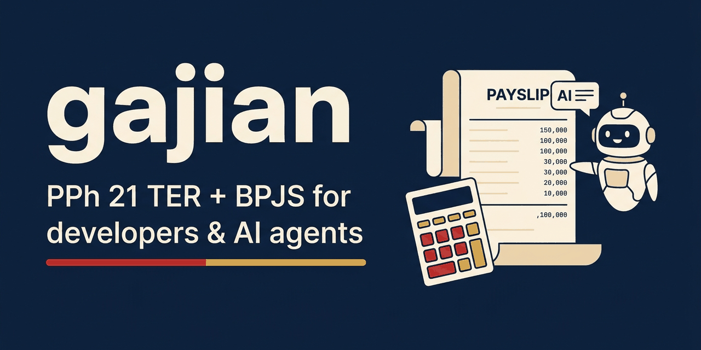

<p align="center">
  
</p>

<p align="center">
  <b>Indonesian payroll math you can cite.</b><br>
  PPh 21 TER + BPJS as a typed library, an MCP server, and an Agent Skill.
</p>

<p align="center">
  <a href="https://www.npmjs.com/package/gajian"></a>
  <a href="LICENSE"></a>
  
  
  
  
  
  
</p>

<p align="center">
  <a href="#-use-it">Use it</a> ·
  <a href="#-api">API</a> ·
  <a href="#-sources">Sources</a> ·
  <a href="#-scope">Scope</a> ·
  <a href="#-bahasa-indonesia">Bahasa Indonesia</a>
</p>


## 🤔 Why

PPh 21 changed in 2024: monthly withholding now uses TER (tarif efektif rata-rata) tables from PP 58/2023, December settles the year with Pasal 17, and BPJS has its own rates and wage caps that move by date. LLMs and many online calculators get this wrong:

| Common mistake | What gajian does |
|---|---|
| Picks the wrong TER row, or the wrong category for the PTKP status | All 125 monthly TER rows (A/B/C) + TER harian, transcribed from the PP 58/2023 Lampiran, every boundary tested |
| Leaves employer-paid JKK, JKM and BPJS Kesehatan out of PPh 21 gross | Adds them, citing PMK 168/2023 Pasal 5 |
| Uses an old JP wage cap | Caps are dated; the right one is picked by `period` |
| Applies annual Pasal 17 to a monthly salary | TER for January–November, Pasal 17 only in the December reconciliation |
| Gives a number you can't check | Every result has a `breakdown` with the article and page it came from |

## ✨ What you get

<table>
  <tr>
    <td width="33%" valign="top"><b>📦 Library</b><br>Zero-dependency TypeScript. Integer rupiah, no floats. Payslip, TER monthly/daily, December reconciliation, BPJS.</td>
    <td width="33%" valign="top"><b>🔌 MCP server</b><br><code>npx gajian-mcp</code>. Six tools Claude, Cursor or ChatGPT can call instead of guessing.</td>
    <td width="33%" valign="top"><b>🧠 Agent Skill</b><br>A <code>SKILL.md</code> that tells agents when to call gajian, what to ask first, and how to explain the result.</td>
  </tr>
  <tr>
    <td valign="top"><b>📜 Cited rules</b><br>Every rate, bracket and cap carries <code>effectiveFrom</code> and the regulation, article and page.</td>
    <td valign="top"><b>✅ 248 tests</b><br>Including the worked examples in the Lampiran of PMK 168/2023 and every TER bracket boundary.</td>
    <td valign="top"><b>🗓️ Versioned</b><br>A rule change is a new dated entry, not a rewrite. Old periods keep their old rules.</td>
  </tr>
</table>

### A payslip, explained

`payslip()` for gaji pokok Rp10.000.000, status K/1, June 2025, office work (JKK class *sangat rendah*):

| Line | Amount (Rp) |
|---|---:|
| Gaji pokok | 10.000.000 |
| + JKK, JKM, BPJS Kesehatan paid by employer | 454.000 |
| **Penghasilan bruto (TER base)** | **10.454.000** |
| − Employer contributions (taxed, not paid out) | −454.000 |
| PPh 21: TER category B, 1,5% × 10.454.000 | −156.810 |
| JHT 2% | −200.000 |
| JP 1% | −100.000 |
| BPJS Kesehatan 1% | −100.000 |
| **Take-home pay** | **9.443.190** |

## 🚀 Use it

### 1. Library (Node >= 22, ESM, zero dependencies)

```bash
npm i gajian
```

Monthly payslip (January-November):

```ts
import { payslip } from 'gajian';

const slip = payslip({
  components: [{ label: 'Gaji pokok', amount: 10_000_000, fixed: true }],
  status: 'K/1',
  period: '2025-06',
  jkkClass: 'sangatRendah',
});
slip.gross;      // 10454000  (salary + employer JKK 24000 + JKM 30000 + BPJS Kesehatan 400000)
slip.pph21.tax;  // 156810    (TER B 1,5%)
slip.takeHome;   // 9443190   (minus PPh 21, JHT 200000, JP 100000, Kesehatan 100000)
slip.breakdown;  // [{ label: 'Potongan PPh 21', amount: 156810, rule: 'PP 58/2023 Pasal 2 ayat (5); Lampiran ...' }, ...]
```

December reconciliation for the same employee over 2025:

```ts
import { pph21December } from 'gajian';

pph21December({
  annualGross: 125_448_000,       // 12 x 10.454.000
  annualEmployeeJhtJp: 3_600_000, // 12 x (200.000 + 100.000)
  status: 'K/1',
  year: 2025,
  taxWithheldJanNov: 1_724_910,   // 11 x 156.810
});
// { biayaJabatan: 6000000, netIncome: 115848000, ptkp: 63000000, pkp: 52848000,
//   annualTax: 2642400, taxWithheldJanNov: 1724910, decemberTax: 917490, overpaid: 0, breakdown: [...] }
```

### 2. MCP server

Claude Code:

```bash
claude mcp add gajian -- npx -y gajian-mcp
```

Claude Desktop, Cursor and other MCP clients:

```json
{ "mcpServers": { "gajian": { "command": "npx", "args": ["-y", "gajian-mcp"] } } }
```

Tools: `payslip`, `pph21_monthly`, `pph21_daily`, `pph21_december`, `bpjs_contributions`, `list_rules`. Inputs match the library functions; bad input comes back as a tool error.

### 3. Agent Skill

Copy [`skills/gajian`](skills/gajian) to `~/.claude/skills/` (or `<project>/.claude/skills/`). The skill tells the agent when to call gajian, what to ask before computing, and to never compute TER from memory.

## 📚 API

All money is integer rupiah. `period` is `'YYYY-MM'`. `status` is `'TK/0'`..`'TK/3'`, `'K/0'`..`'K/3'`. `jkkClass` is `'sangatRendah' | 'rendah' | 'sedang' | 'tinggi' | 'sangatTinggi'`.

| Function | Inputs | Returns |
|---|---|---|
| `payslip` | `{ components: [{ label, amount, fixed }], status, period, jkkClass, kesehatanFloor?, jpWageCap? }` (January-November; December throws) | `{ bpjs, pph21, gross, takeHome, breakdown }` |
| `pph21Monthly` | `{ gross, status, period }` (gross includes employer JKK, JKM, BPJS Kesehatan) | `{ category, rateBp, tax, breakdown }` |
| `pph21Daily` | `{ dailyGross, period }` (pegawai tidak tetap paid daily) | `{ method: 'TER harian' \| 'Pasal 17', rateBp, base, tax, breakdown }` |
| `pph21December` | `{ annualGross, annualEmployeeJhtJp, status, year, taxWithheldJanNov }` | `{ biayaJabatan, netIncome, ptkp, pkp, annualTax, taxWithheldJanNov, decemberTax, overpaid, breakdown }` |
| `bpjs` | `{ wage, period, jkkClass, kesehatanFloor?, jpWageCap? }` | `{ jht, jkk, jkm, jp, kesehatan }` each `{ base, employer, employee }`, plus `totals`, `breakdown` |
| `getPtkp` | `(status, year)` | `{ status, year, amount, breakdown }` |
| `getTerCategory` | `(status)` | `'A' \| 'B' \| 'C'` |
| `rules` | - | all loaded rule data with `effectiveFrom` and `source` |

Rates are basis points (`rateBp: 150` = 1,5%). Tax is rounded down to whole rupiah; each function's TSDoc states its rounding.

## 📜 Sources

Generated from the rule data in [`packages/gajian/src/rules/`](packages/gajian/src/rules). `primary` = read from the regulation itself; `secondary` = no official primary document found.

| Rule | Regulation | Effective from | Verification |
|---|---|---|---|
| `terMonthly` | PP 58/2023, Pasal 2 ayat (5); Lampiran huruf A (hlm. 1-5), B (hlm. 6-10), C (hlm. 10-14) | 2024-01-01 | primary |
| `terDaily` | PP 58/2023, Pasal 2 ayat (6); Lampiran huruf D (hlm. 15) | 2024-01-01 | primary |
| `terCategoryByStatus` | PP 58/2023, Pasal 2 ayat (4) (hlm. 4) | 2024-01-01 | primary |
| `ptkp` | PMK 101/PMK.010/2016, Pasal 1 huruf a, b, d (hlm. 2-3); Pasal 3 | 2016-01-01 | primary |
| `pasal17` | UU 7/2021 (HPP), Pasal 3 angka 7: Pasal 17 ayat (1) huruf a UU PPh (hlm. 56) | 2022-01-01 | primary |
| `biayaJabatan` | PMK 168/2023, Pasal 10 ayat (2) (hlm. 12); Pasal 24 huruf a; Pasal 25 | 2024-01-01 | primary |
| `iuranPensiunDeduction` | PMK 168/2023, Pasal 10 ayat (1) huruf b (hlm. 11-12) | 2024-01-01 | primary |
| `jht` | PP 46/2015, Pasal 16 ayat (1) (hlm. 11); Pasal 37 | 2015-07-01 | primary |
| `jkk` | PP 44/2015, Pasal 16 ayat (1) huruf a-e (hlm. 12); Pasal 63 | 2015-07-01 | primary |
| `jkm` | PP 44/2015, Pasal 18 ayat (1) (hlm. 13); Pasal 63 | 2015-07-01 | primary |
| `jp` | PP 45/2015, Pasal 28 ayat (2)-(3) (hlm. 20-21) | 2015-07-01 | primary |
| `jpWageCap` | PP 45/2015, Pasal 29 ayat (2) (hlm. 21) | 2015-07-01 | primary |
| `jpWageCap` | BPJS Ketenagakerjaan, JP wage cap 2024 (letter as published by secondary sites) | 2024-03-01 | secondary |
| `jpWageCap` | BPJS Ketenagakerjaan, JP wage cap 2025 (letter as published by secondary sites; Rp10.547.400 shown as current on bpjsketenagakerjaan.go.id, read 2026-11-02) | 2025-03-01 | secondary |
| `kesehatan` | Perpres 64/2020, Pasal I angka 3 (Pasal 30 ayat (1)) and angka 5 (Pasal 32) | 2020-05-06 | primary |
| `kesehatan` | Perpres 59/2024, Pasal I angka 7 (Pasal 32, hlm. 11-12) | 2024-05-08 | primary |

Note on the JP wage cap: the 2024 and 2025 values are `secondary`, and no 2026 value is loaded yet, so 2026 periods use the 2025 cap. The 2016-2023 adjustments are also missing (those periods fall back to the 2015 cap). If you have the BPJS Ketenagakerjaan letter for your period, pass it as `jpWageCap`. `list_rules` (MCP) and `rules` (library) show what is loaded.

## 🎯 Scope

Covered: PPh 21 for pegawai tetap (TER bulanan January-November, December reconciliation), pegawai tidak tetap (TER harian / Pasal 17, or TER bulanan if paid monthly), PTKP, BPJS Ketenagakerjaan (JHT, JKK, JKM, JP) and BPJS Kesehatan for peserta penerima upah. Periods from 2024-01.

Not covered:
- Part-year employees in December (annualisation, biaya jabatan cap of Rp500.000 x months worked).
- Zakat / sumbangan keagamaan wajib through the employer; other pension (DPLK) unless added to `annualEmployeeJhtJp`.
- Higher rate for recipients without NPWP.
- Gross-up / tunjangan pajak (PPh 21 borne by the employer).
- Pensiunan and PNS rules, PPh 21 for non-pegawai.
- THR and pesangon as separate rules.
- UMK/UMP lookup (pass `kesehatanFloor`), holidays, NPWP/NIK validation.
- JP wage caps for 2016-2023 (pass `jpWageCap`).
- Storage of personal data: everything is pure functions.

## 🗺️ Roadmap

- UMK/UMP dataset, with the SK Gubernur number cited per row.
- Zakat via employer.
- Part-year annualisation in December.
- Gross-up (tunjangan pajak).
- Higher rate without NPWP.
- THR.
- Pesangon.

## ⚠️ Disclaimer

This is not tax advice. gajian follows the cited regulations as closely as its tests can check, but check results against the regulation (and your tax consultant) before you rely on them.

## 📄 License

MIT. Contributions: see [CONTRIBUTING.md](CONTRIBUTING.md).

---

## 🇮🇩 Bahasa Indonesia

gajian menghitung PPh 21 (TER PP 58/2023, rekonsiliasi Desember dengan Pasal 17) dan iuran BPJS (JHT, JKK, JKM, JP, Kesehatan) sebagai library TypeScript, server MCP, dan Agent Skill. Setiap tarif dan batas upah punya tanggal berlaku dan rujukan pasal + halaman regulasinya, dan setiap hasil punya `breakdown` baris per baris dengan dasar hukumnya.

- Library: `npm i gajian`, lalu `payslip(...)` untuk slip Januari-November dan `pph21December(...)` untuk Desember (contoh di atas).
- MCP: `claude mcp add gajian -- npx -y gajian-mcp`.
- Agent Skill: salin folder `skills/gajian` ke `~/.claude/skills/`.

Batas upah JP 2024 dan 2025 bersumber sekunder, dan nilai 2026 belum dimasukkan; isi `jpWageCap` kalau punya surat BPJS Ketenagakerjaan yang lebih baru. Belum mencakup THR, pesangon, UMK/UMP, karyawan yang masuk/keluar di tengah tahun, gross-up, dan tarif tanpa NPWP.

Bukan nasihat pajak. Cocokkan hasilnya dengan regulasi.
